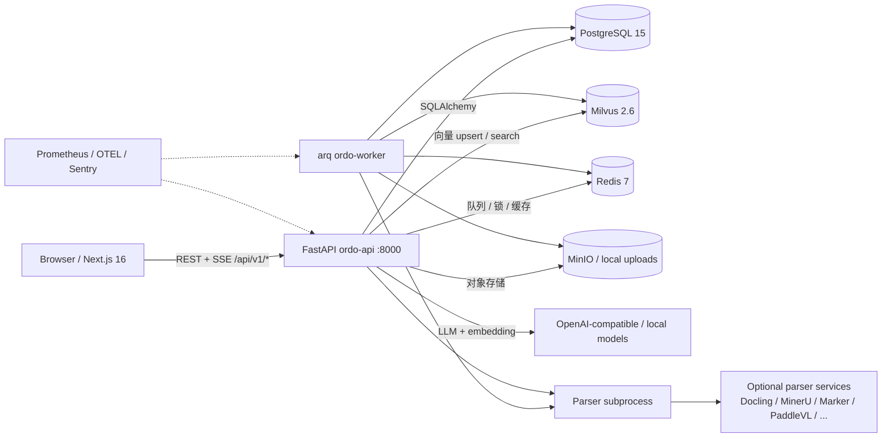
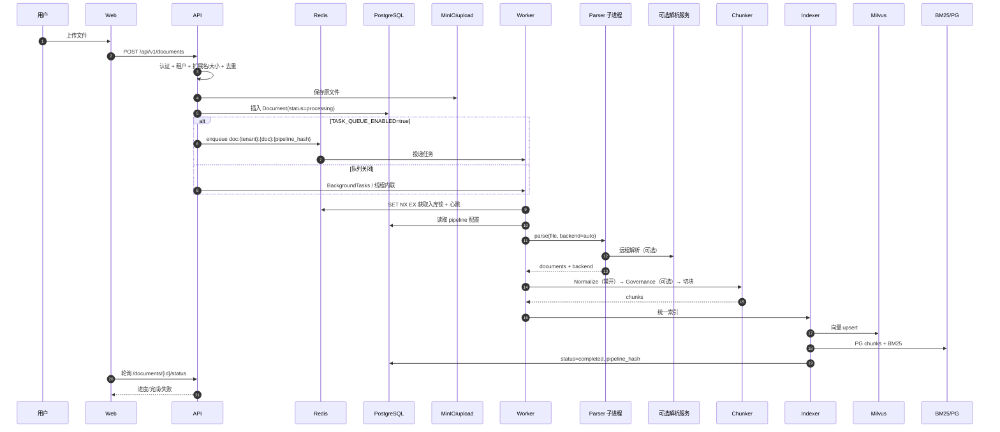
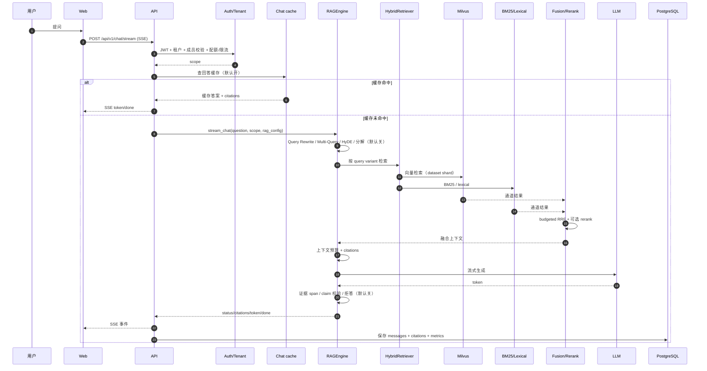
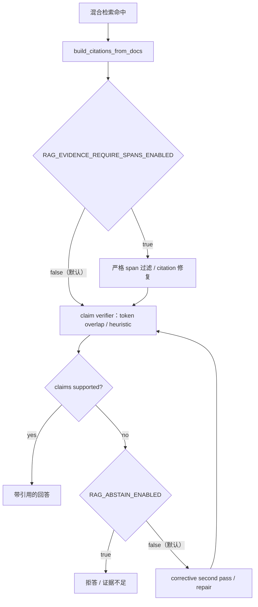
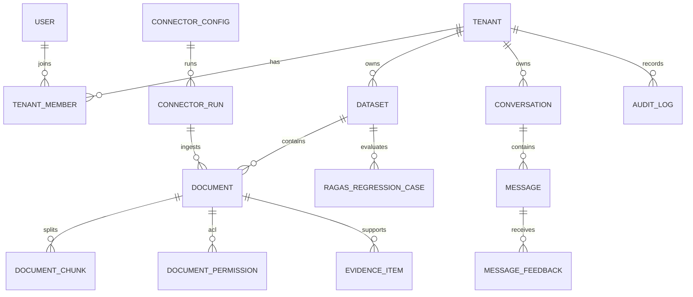

# P0 加固与架构图（v1.0.2）

本文记录 v1.0.2 的三项 P0 修复，以及 Ordo 的核心架构图与关键时序图。图中虚线/注释表示默认关闭或可选分支。

## 1. 已落地的 P0 修复

### 1.1 向量后端 fail-fast

- `VECTOR_BACKEND` 只接受 `milvus`、`memory`、`faiss`、`chroma`。
- `qdrant` / `pgvector` 的占位实现不再注册到工厂；显式选择会在 `get_vector_store()` 阶段直接抛 `ValueError`。
- 未知 backend 不再回落到 `StubVectorStore`；`VECTOR_REGION_BACKENDS` 也会在运行时二次校验。
- `memory` 标记为 `ephemeral`，生产环境启动校验直接拒绝；readiness 的 `vector` 字段会返回 `persistence`。
- 旧的占位模块保留为兼容导入，但不再有工厂路径；如确认不再需要，可在下一次清理中移入 `backups/`。

### 1.2 发布基线

- 以 `v1.0.1` 标注既有基线，本次改动版本为 `1.0.2`。
- `app/__init__.py`、`web/package.json`、Helm `appVersion`、README badge、最新发布说明由 `scripts/release/check_versions.py` 统一校验。
- `make check-versions`、`make release-check`、`make release-tag VERSION=x.y.z` 已加入 Makefile。
- `.github/workflows/release.yml` 在 `v*` tag 上复核版本、构建并推送 API/Web 镜像、创建 GitHub Release。

### 1.3 PDF 解析去 PyMuPDF

- 默认 `basic` PDF 解析器改用 `pdfplumber`（文本、坐标、嵌入图片、页面渲染），质量评分改用 `pypdf` 读取旋转与注释。
- `PyMuPDF` 从 `requirements.txt` 移除，放入可选的 `requirements-agpl.txt`；默认镜像不包含 AGPL 运行时。
- 仍使用 PyMuPDF 的可选能力（OCR 校验、图像预处理、水印、VLM 校正、DeepSeek OCR、ETL4LLM、Docling 回退）改为惰性加载；未安装时抛出带许可证说明的 `RuntimeError`。
- 新增测试：`test_pdf_parser_parity.py`、`test_no_agpl_default_imports.py`、`test_vector_backend_contracts.py`、`test_version_consistency.py`。

## 2. 容器与依赖关系



要点：

- API 与 Worker 共用镜像；Worker 承担持久化入库，API 在队列关闭时退化为后台线程/内联处理。
- BM25 默认是进程内索引；多副本部署需要每副本预热，或切换到共享 PostgreSQL 词法召回。
- LLM/Embedding 是外部服务；默认栈不包含本地大模型。

## 3. 文档入库时序



要点：

- 解析在独立子进程里做，避免 OCR/解析阻塞 API 事件循环；失败落 `IngestDeadLetter`，可 replay。
- 索引是“三写”：Milvus、PG chunks、BM25；任何一路失败都会影响检索通道，需要看 `DocumentIndexChannel` 状态。

## 4. 问答/检索时序



要点：

- 默认路径是 Milvus + BM25/lexical + budgeted RRF，不重排、不强制 span、不拒答。
- 回答缓存默认开，且要求空历史才命中；多轮对话不会误用单轮缓存。
- 检索 admission timeout 默认 15s，超时返回 503，而不是静默空结果。

## 5. 证据/引用校验流



合规场景应显式打开 `RAG_EVIDENCE_REQUIRE_SPANS_ENABLED` 与 `RAG_ABSTAIN_ENABLED`。

## 6. 核心数据模型（简化）



## 7. 验证命令

```bash
python scripts/release/check_versions.py
pytest -q tests/test_pdf_parser_parity.py tests/test_no_agpl_default_imports.py
pytest -q tests/test_vector_backend_contracts.py tests/test_version_consistency.py
ruff check app/parsing/parsers/pdf_parser.py app/storage/vector/factory.py
```

完整解析回归建议使用：

```bash
python -m app.rag.evaluation.parse_bench run \
  --input-dir tests/fixtures/parsing_golden \
  --manifest tests/fixtures/parsing_golden/manifest.json \
  --parsers basic --max-files 8 \
  --out artifacts/parser_benchmark.plumber.json \
  --baseline ci/parser_benchmark_baseline.v1.json \
  --strict-profile ci/parser_strict_profile.v1.json --strict
```
